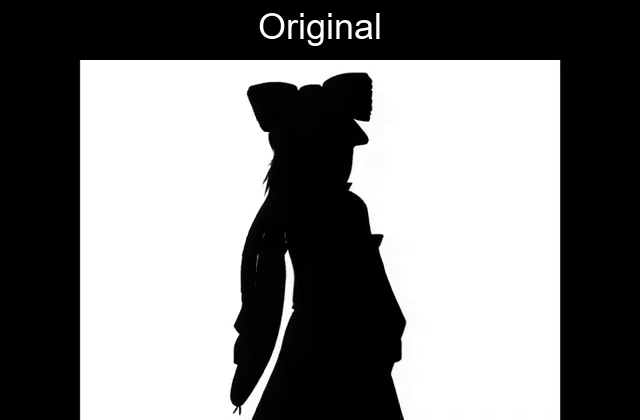

# Unicode Lossful Format (ULF)

A deliberately silly text-based video format. ULF represents video frames using Unicode characters, choosing glyphs that visually resemble parts of the original image.

It supports audio, delta-frame compression, GPU acceleration, and MP4 export.

## Comparison



## Requirements

Python 3.10+.

Install the dependencies:

```bash
python -m pip install opencv-python pillow numpy fonttools wgpu rendercanvas sounddevice regex
```

FFmpeg must be installed and available on your system PATH for MP4 export.

## Encode

```bash
python ulf_encode.py input.mp4 output.ulf --size 80x40
```

### Options

- `--size WIDTHxHEIGHT`: Character-grid resolution (default: `80x40`).
- `--fps N`: Output frame rate.
- `--font PATH`: Font used for glyph matching.
- `--every N`: Encode every Nth source frame.
- `--backend auto|vulkan|cpu`: Select processing backend.
- `--keyframe-interval N`: Set the interval between full frames.
- `--mute`: Disable audio.
- `--audio-waves N`: Set audio reconstruction detail.
- `--emojiless`: Exclude emoji characters.
- `--hackerman`: Use printable keyboard ASCII characters only.
- `--debug`: Enable diagnostic output.

## Play

```bash
python ulf_play.py output.ulf
```

### Options

- `--window WIDTHxHEIGHT`: Set playback window size.
- `--font PATH`: Select playback font.
- `--backend auto|vulkan|cpu`: Select playback backend.
- `--mute`: Disable audio.
- `--debug`: Enable diagnostic output.

## File format

ULF files use the `.ulf` extension and are stored as UTF-8 text.

The format uses the `ULF/1.0` signature and supports full-frame and delta-frame video, with optional audio data.

## Limitations

- Video is grayscale.
- Audio reconstruction is lossy.
- Visual quality depends on the selected font and renderer.
- Vulkan requires compatible hardware and drivers.
- MP4 export requires FFmpeg.
- Large resolutions can increase processing time and file size.

## Have fun

ULF makes video less efficient on purpose.

Now with compression, GPU acceleration, sound, and MP4 export!